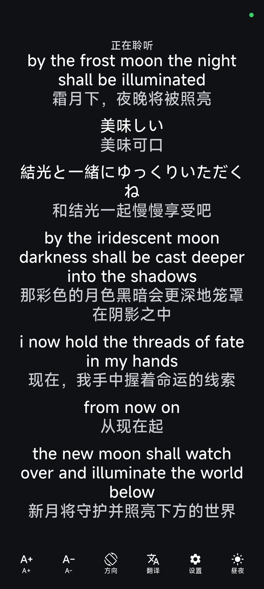
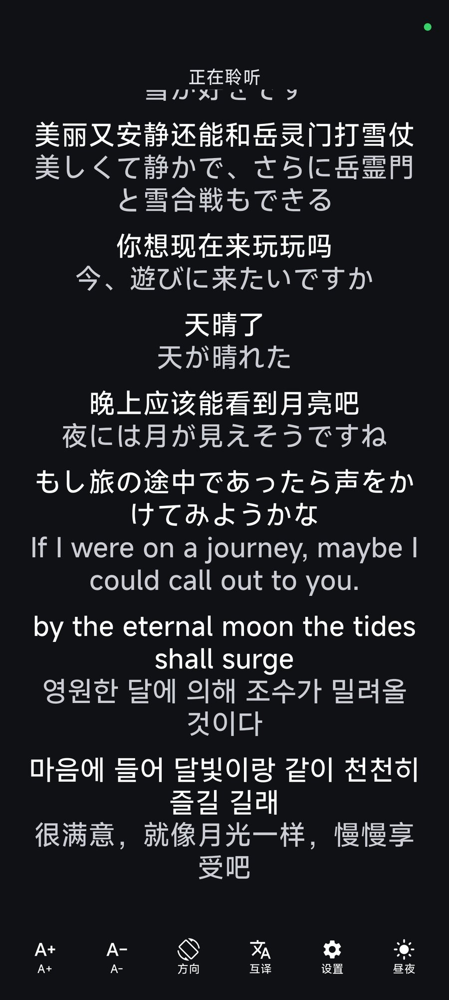
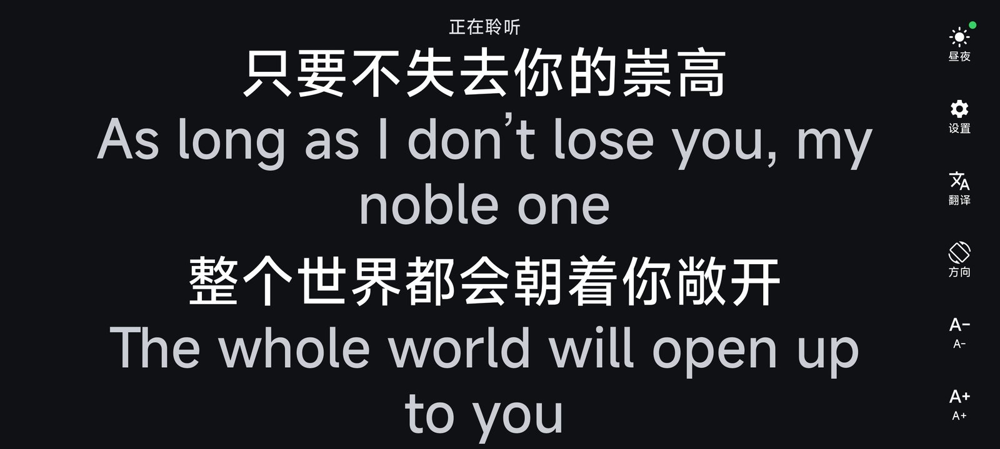
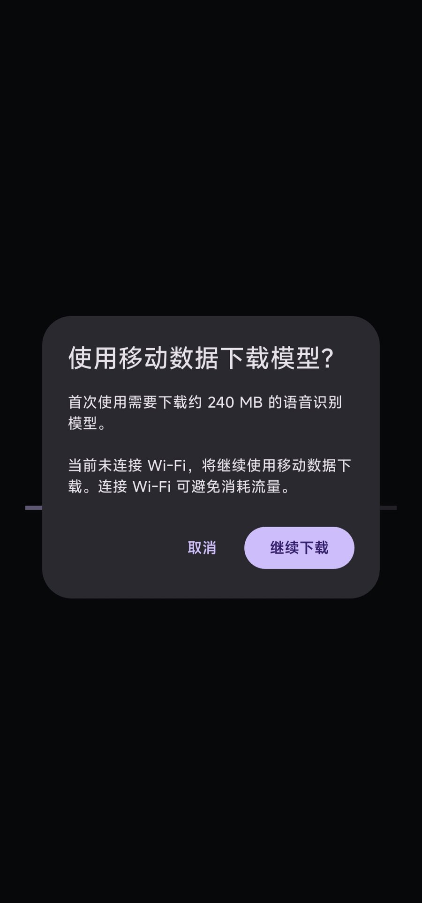

# Loud Caption (大字幕)

<p align="center">
  
</p>

<p align="center">
  <strong>Real-time, offline, large captions for Android.</strong><br>
  For people who can hear sound but struggle to make out speech.
</p>

<p align="center">
  <a href="https://github.com/DR1N0/loud-caption/actions/workflows/ci.yml"></a>
  <a href="https://github.com/DR1N0/loud-caption/releases/latest"></a>
  <a href="LICENSE"></a>
</p>

Loud Caption turns nearby speech into large, high-contrast text on an Android
phone. Speech recognition runs entirely on-device with
[sherpa-onnx](https://github.com/k2-fsa/sherpa-onnx) (SenseVoice + Silero VAD),
so no audio is uploaded. An optional on-device model
([Hy-MT2-1.8B](https://github.com/Tencent-Hunyuan/Hy-MT2)) can show a second
line in another language, also without a cloud service.

## Why it exists

This started as a small app for my grandfather. His hearing loss does not make
speech quieter; it makes speech sound muffled. A hearing aid can amplify sound,
but it cannot restore clarity. Large, immediate text lets him follow the
conversation instead of guessing at it.

That use case sets the priorities: **low latency, readable text, offline
operation, and as few taps as possible**. Everything else is secondary.

## What it does

- **Live captions** in Chinese, English, Japanese, Korean, and Cantonese, with
  automatic language detection.
- **Large, high-contrast text** from 16 to 80 px, with auto-scroll and
  scroll-back to re-read an earlier line.
- **On-device translation** in two modes: one target language for every line
  (翻译), or a per-source-language routing table (互译).
- **Landscape side rail**, day/night theme, and a settings screen that does not
  interrupt recognition.
- **Chinese and English interface**, following the system language by default
  or chosen in Settings; model prompts stay language-neutral.
- **Download once, then work offline.** The app needs the network only to fetch
  its pinned, checksum-verified model files.

## Screenshots

<p align="center">
  
  
  
</p>
<p align="center"><sub>Captions · Translation · Per-language routing</sub></p>

<p align="center">
  
  
</p>
<p align="center"><sub>Landscape with a large font · First-run mobile-data prompt</sub></p>


## Install

Loud Caption is distributed as a sideloaded APK, not through Google Play.

### Obtainium (recommended)

Install [Obtainium](https://github.com/ImranR98/Obtainium), add this repository
URL as a source, and let it follow GitHub Releases:

```text
https://github.com/DR1N0/loud-caption
```

### APK

Download `app-release.apk` from the
[latest release](https://github.com/DR1N0/loud-caption/releases/latest) and open
it. You will need to allow installs from your browser or file manager.

- Android 8.0 (API 26) or newer, arm64-v8a.
- The APK is about 52 MB. On first launch the app downloads and verifies
  ~240 MB of ASR/VAD models. Entering a translation mode later downloads the
  ~1.08 GB translation model.
- Downloads resume if interrupted. On a non-Wi-Fi connection the app warns that
  the download will use mobile data and asks for confirmation first.
- After the models are installed, recognition and translation work without a
  network connection.

> **0.0.4 and later use the application ID `app.loudcaption`.** The 0.0.3
> package was `app.loudcaption.loud_caption`; uninstall it once before
> installing 0.0.4. Your models are downloaded again under the new app.

## How it works

- **ASR/VAD**: SenseVoice int8 with Silero VAD, running through sherpa-onnx.
  VAD segments the microphone stream; partial results are re-decoded while the
  speaker continues, and only finalized segments become committed captions.
- **Translation**: Hy-MT2-1.8B Q4_K_M through llama.cpp, on the CPU. Only
  committed lines are translated, so translation cannot fall behind live speech
  and block the caption pipeline.
- **Model delivery**: pinned URLs and SHA-256 values, mirror fallback,
  resumable `.part` downloads, stall detection, and atomic installation. See
  [docs/model-sources.md](docs/model-sources.md) for exact sizes and licenses.

## Privacy

- No account, analytics, telemetry, or cloud ASR/translation.
- Audio and recognized/translated text are never persisted or uploaded.
- The only network requests are the model downloads; the release manifest
  requests `INTERNET` and `ACCESS_NETWORK_STATE` for that purpose.
- Crash logs are local and size-capped, with a manual copy/clear action in
  Settings. Nothing is sent automatically.

## Status

Tested in normal conversation on two Android phones, including my
grandfather's. No thermal or battery problems were observed in that use, and
the app behaves like other continuously-running apps on those devices; this is
not a formal benchmark. Recognition language is detected automatically by
SenseVoice and cannot be forced, so strongly accented or slurred speech may
occasionally be labelled as another language. Accuracy across accents,
devices, and long sessions will improve with more reports. Translation is
optional and currently Android only; iOS, cloud sync, caption history, and
accounts are out of scope.

## Build and test

Requires Flutter 3.47.x, JDK 17, and the Android SDK (platform 36, build-tools
36.0.0, NDK 28.2.13676358).

```bash
flutter pub get
flutter analyze
flutter test
flutter build apk --release --target-platform android-arm64 --split-per-abi
flutter build appbundle --release --target-platform android-arm64
```

Release signing uses a private upload keystore supplied through
`android/key.properties` locally or `ANDROID_KEYSTORE_*` secrets in CI. See
[docs/release.md](docs/release.md); no key or password is committed.

See [CONTRIBUTING.md](CONTRIBUTING.md) before opening a pull request.

## Documentation

- [Architecture](docs/architecture.md)
- [Architecture decisions](docs/adr/)
- [Model sources, sizes, checksums, and licenses](docs/model-sources.md)
- [Release and signing](docs/release.md)
- [Testing and release checklist](docs/testing.md)
- [Device testing](docs/device-testing.md)
- [Documentation index](docs/README.md)

Dated implementation plans are intentionally kept out of the repository; a
stale plan is worse than no plan.

## License

The code in this repository is licensed under the [MIT License](LICENSE).

Model files are **not** part of this repository and remain under their own
licenses: SenseVoice weights use the FunASR Model Open Source License Agreement
v1.1, Silero VAD is MIT, and Hy-MT2 is Apache-2.0. See
[docs/model-sources.md](docs/model-sources.md) and
[THIRD_PARTY_NOTICES.md](THIRD_PARTY_NOTICES.md) for details.

[中文说明](README.zh.md)
