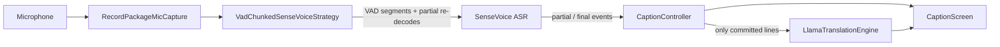
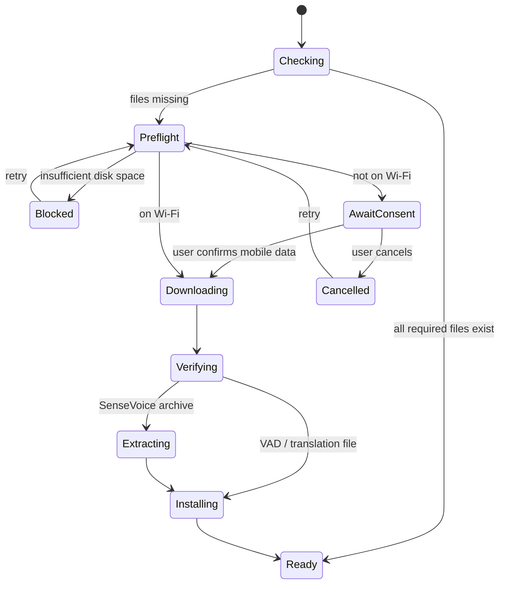

# Architecture at a glance

Loud Caption is a **single-process, offline-first Android app**. There is no
backend, account, telemetry, or audio upload. The only network access is
downloading the pinned model files described in
[model-sources.md](model-sources.md).

This page describes the current system. It is not a roadmap and should only be
updated when a module boundary, data flow, or invariant changes.

## Module map

| Area | Main files | Responsibility |
|---|---|---|
| Bootstrap | `lib/main.dart` | Builds the app, checks whether models exist, gates the UI on the download screen, owns the controller/coordinator |
| Lifecycle | `lib/lifecycle/` | Microphone permission, foreground/background policy, screen wake lock, orientation |
| Speech | `lib/speech/` | Mic capture, recognition strategy, SenseVoice engine, VAD chunking, model paths |
| Captions | `lib/captions/` | Partial/committed line state, recognition lifecycle, translation dispatch |
| Translation | `lib/translation/` | Hy-MT2 download and llama.cpp-backed translation engine |
| Downloads | `lib/downloads/` | Streaming download, SHA-256 verification, resume, mirror race, stall timeout, disk/network preflight |
| Settings | `lib/settings/` | Persisted caption/recognition/translation/theme preferences |
| UI | `lib/ui/` | Caption screen, first-run download gate, settings, theme, progress |

## Capture pipeline

The strategy runs in a background isolate. It applies Silero VAD, keeps a
6400-sample pre-roll, and performs a partial re-decode about every 200 ms while
speech is in progress. The engine fences sessions by generation so a late
result from a stopped/restarted session cannot be delivered to the UI.

## Startup and model lifecycle

ASR and VAD are separate downloads. The SenseVoice archive contains
`model.int8.onnx` and `tokens.txt`; `silero_vad.onnx` is a separate file.
The translation model is downloaded only when the user first enters a
translation mode.

Downloads go to a sibling `.part` file while hashing; only a verified file is
renamed into place. Extraction writes to a temporary tar and then installs
each wanted file through a `.part` + rename, so a killed app never leaves a
truncated file at a path that `isSenseVoiceModelReady` treats as installed.

## Threading

| Work | Where |
|---|---|
| UI, state, lifecycle | Flutter UI isolate |
| Mic capture | Platform audio callback / stream |
| VAD + SenseVoice decode | Recognition isolate spawned by the strategy |
| Bzip2/tar extraction | `Isolate.run` in `sense_voice_model_download.dart` |
| Hy-MT2 inference | Native llama.cpp through `llama_flutter_android` |
| Downloads | Asynchronous Dart streams; progress events drive UI |

Heavy work never runs on the UI isolate. The UI shows progress from stream
events and remains responsive while models download or extract.

## Invariants

- The app makes **no network request** other than the pinned model downloads.
- Audio and recognized/translated text are never persisted or uploaded.
- Only checksum-verified model files are installed at their final paths.
- One capture session exists at a time; start/stop and permission changes are
  serialized by the controller/coordinator.
- Only **committed** caption lines are translated.
- UI state is derived from controller/coordinator notifications; model
  download/extraction does not block the Flutter isolate.

## Failure modes

| Failure | Current behavior |
|---|---|
| Mirror times out, returns non-200, or stops mid-body | Race/fallback through candidates, per-connection stall timeout, aggregated error |
| Disk too small | Preflight blocks before download |
| Interrupted download | Resumes from `.part` when the server supports Range |
| Corrupt model/archive | Checksum or extraction error; no file is installed at the final path |
| Mic permission denied | Permission screen; permanent denial opens system settings |
| App backgrounded / screen locked | Capture stops; foreground resume is handled by the lifecycle coordinator |
| Device thermal/battery pressure | Not instrumented; treated as a qualitative release check (see [testing.md](testing.md)) |

## Where to change what

- **Capture behavior / latency** → `lib/speech/vad_chunked_sense_voice_strategy.dart`
  and its tests; keep the engine's generation fencing intact.
- **Recognition lifecycle** → `lib/captions/caption_controller.dart`,
  `lib/lifecycle/caption_lifecycle_coordinator.dart`.
- **Translation** → `lib/translation/`; keep the Hy-MT2 prompt format aligned
  with the upstream template and translate only committed lines.
- **Model files / mirrors / checksums** → `lib/downloads/`,
  `lib/speech/sense_voice_model_download.dart`, `docs/model-sources.md`.
- **UI** → `lib/ui/`; keep accessibility semantics and large touch targets.
- **New UI language** → ARB files and the i18n ADR; do not localize model
  prompt names.
